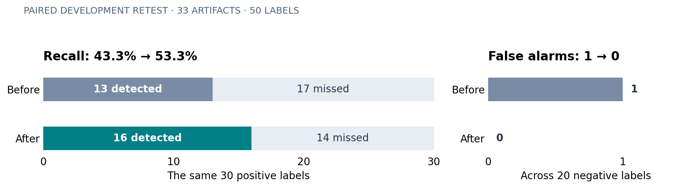

# MCP Security Scanner

## Final project results

**Noam Ben-Lulu · Bar David**  
Networked Software Systems Lab (NSSL), Technion · Supervisor: Sorana Fraier  
Results snapshot: **17 October 2026**

> **From a two-threat prototype to a working security analysis workflow:** source discovery, static analysis, actionable reports, conservative remediation, and reproducible evaluation.

The project delivers a practical way to inspect an MCP server before deployment: provide a source file or project directory, run the analyzer, and inspect findings in the terminal, JSON, or a standalone HTML report. The target server is never executed. Findings include the rule, severity, source location, evidence, and recommended action.

| Delivered capability | Result |
|---|---|
| Security catalog | **16 categories and 25 stable rules**, catalog version 2026.1 |
| Inputs | Python; supported JavaScript/TypeScript MCP patterns; configuration and dependency manifests |
| Analysis | AST extraction, metadata heuristics, bounded data-flow and linked-module analysis |
| Developer workflow | Real target-path scan, console/JSON output, and a linked HTML report |
| Remediation | Conservative automatic fixes for eligible Python MCP03/MCP06 findings; dry-run, backups, and verification |
| Evaluation discipline | Frozen manifests, explicit labels, scanner/source hashes, saved predictions, and consumed-reserve tracking |

### The strongest measured improvement

On the **same 50 development labels**, the improved scanner recovered **three additional positive cases** and removed **one false alarm**. Recall rose from **43.3% to 53.3%**, a **10 percentage-point increase**. Missed positives fell from **17 to 14**.



These are development gains on an already exposed set. A subsequent reserved evaluation found an unresolved tool-extraction gap, detailed on page 3. The contribution is a working, tested scanner with measurable improvements and a documented path to better coverage; universal detection has not been established.

<div class="page-break"></div>

## What the measurements show

**Recall** is the fraction of labeled positive cases detected: TP / (TP + FN). Increasing recall reduces missed signals. **Precision** is the fraction of scored positive predictions that match positive labels: TP / (TP + FP). A finding count alone measures neither.

| Evaluation stage | Scope | TP | FP | FN | TN | Precision | Recall |
|---|---|---:|---:|---:|---:|---:|---:|
| Original reserved run · 16 Oct | 33 artifacts; 50 labels | 13 | 1 | 17 | 19 | 92.9% | 43.3% |
| Development retest · round 008 | Same artifacts and labels | 16 | 0 | 14 | 20 | 100% | 53.3% |
| Development · round 009 | 12 adapted text records | 6 | 0 | 0 | 6 | 100% | 100% |
| Development · round 010 | 12 synthetic fixtures | 6 | 0 | 0 | 6 | 100% | 100% |
| New reserved run · 17 Oct | 10 native files; one MCP03 rule | 0 | 0 | 2 | 8 | Undefined | 0% |

TP = correctly detected positive; FP = false alarm; FN = missed positive; TN = negative without an alarm. Scores apply to explicit artifact/rule labels; they are not counts of independently confirmed exploitable vulnerabilities. Do not pool these rows: the first two reuse the same cases, and the other sets have different purposes and scopes.

### Three development rounds, concrete repairs

| Round | Change measured | Recall before → after | Interpretation |
|---|---|---|---|
| 008 | Programmatic Python tool registration and derived docstrings; later script/HTTP repairs | 43.3% → 53.3% | Broader extraction and flow coverage recovered 3 of the 17 original misses. |
| 009 | Metadata that requires sensitive-data collection and transmission | 33.3% → 100% | Four additional positives found in 12 adapted records from an already exposed source family. |
| 010 | Executable script calls, safe argument boundaries, and external text propagation | 66.7% → 100% | Two additional positives found; four false alarms removed in 12 synthetic fixtures. |

Round 008 reports the final candidate after all three rounds. Its recovered cases concern derived Python metadata, JavaScript dynamic code, and Python HTTP text returned by a tool. These are interpretable engineering improvements, with focused negative controls as well as positive examples.

**Regression evidence:** every individual labeled outcome in development rounds 001–007 stayed unchanged when comparing the saved initial scanner with the final candidate. Existing misses and false alarms also remained; this is a scoped regression check, not proof of complete correctness.

**Software verification:** 172 tests passed at the evaluation freeze. The subsequent live-demo and HTML-report additions brought the latest passing suite to 180 tests. Unit tests establish tested software behavior; they do not replace independent detection evaluation. The frozen scanner was not changed after the new reserved run.

<div class="page-break"></div>

## Reserved validation: an actionable coverage finding

The original reserved evaluation used **33 pinned artifacts from seven repositories**, with **30 positive and 20 negative labels** covering **eight categories and ten rules**. It produced **92.9% precision and 43.3% recall within labeled scope**. Another **37 predictions had no matching reviewed label** and were excluded from scoring, so the precision figure does not describe all emitted findings. Once inspected for improvements, this set became development data.

For the next evaluation, the scanner was frozen before reviewing a new reserve of **10 native MCP-DecayBench files**, containing **two positive and eight negative MCP03 labels**. Labels were recorded before predictions. The run saved hashes, predictions, and a scanner snapshot; the reserve was consumed once.

| New reserve result | Observation |
|---|---|
| Positive cases detected | **0 of 2**; recall **0%** |
| False alarms on negative labels | **0 of 8** |
| Recognized tools | **0 across the 10 files** |
| Scan errors | **0** |
| Precision | **Undefined**, because there were no positive predictions |

### Diagnosis: metadata never reached the detector

The tool-bearing fixtures expose descriptions through handwritten JSON-RPC `tools/list` dispatch and module-level dictionaries. The current extractor does not recognize that registration style. Successful file parsing therefore did not mean successful tool discovery. Both missed positives remain false negatives in the reported score.

This isolates a concrete next engineering priority: **extend tool registration extraction**, then test it against ordinary dictionaries and non-MCP controls. The zero false-alarm result does not demonstrate strong negative discrimination, because the relevant tool metadata was not analyzed.

### What we can and cannot conclude

- **Supported:** the project implements an end-to-end static analysis workflow and produces useful evidence for supported source patterns. Targeted development changes improved measured recall while reducing false alarms on the stated cases.
- **Not established:** reliable detection across arbitrary MCP implementations, all 16 catalog categories, runtime behavior, or unknown attacks. The original evaluation covered only part of the catalog.
- **Evaluation limits:** small, curated sets; correlated templates; adapted and synthetic development examples; labels still requiring independent human adjudication. The new reserve covers one rule and one shared implementation family, so its 0% recall is specific to that set.
- **No cross-corpus guarantee:** no exact-byte matches were found against 290 distinct admitted development hashes, but semantic and template overlap remain possible. The runs used deterministic analysis without LLM review and did not execute third-party servers. Individual-artifact evaluation does not comprehensively validate cross-file analysis.

<div class="page-break"></div>

## Demonstrating the delivered system

From the repository root in PowerShell, run the analyzer on an included server fixture:

```powershell
python demo.py .\tests\samples\vulnerable_tool_poisoning.py --html scan-report.html
Start-Process .\scan-report.html
```

The command analyzes the file on that run and prints a clickable HTML link. The report and console output come from the same scan result. To inspect another server, replace the sample path with an existing server file or project directory. This is static analysis of the server's source; it does not start the server or perform live penetration testing.

For the presentation, show one finding from source to report: the suspicious metadata, its rule and source location, the evidence, and the recommendation. The included fixture is intentionally vulnerable; its finding count is a demonstration of functionality, not an accuracy benchmark. Exit code **1** means findings were detected; **0** means no findings; **2** means an error or incomplete demo scan.

### Practical value and next steps

The scanner makes a repeatable review workflow available without running unfamiliar server code. Stable rule IDs and JSON output support automation, while the HTML report makes the same evidence accessible to a reviewer. Conservative fixes support reviewable remediation; other categories remain report-only, and even eligible categories may retain findings after a partial fix.

The next work should proceed in this order:

1. Recognize handwritten JSON-RPC tool registration and expose incomplete extraction clearly.
2. Investigate remaining misses involving obfuscated metadata, helper functions, temporary-file execution, scope checks, and name confusion.
3. Independently review labels and broaden rule, registration-style, and repository coverage.
4. Freeze the improved scanner and evaluate a newly reserved set. Both previously scored reserves are now consumed.

There are **820 unadmitted text records** remaining in the recorded workflow. They are candidate material for future review and development, not 820 validated or independent test cases.

### Evidence available for review

- [Original validation report](Final_Validation_Report.md) and [original scored metrics](../evaluation/holdout/metrics.json).
- [Follow-up validation report](Followup_Validation_Report.md), [paired candidate metrics](../evaluation/followup/working-regressions.json), and [individual decision comparison](../evaluation/followup/comparison.json).
- [New reserved metrics](../evaluation/followup/final/results/metrics.json), [manifest](../evaluation/followup/final/manifest.json), and [consumed marker](../evaluation/followup/final/CONSUMED.json).
- [Current implementation and usage](../README.md), [rule catalog](../mcp_scanner/catalog.py), and [live HTML example](../scan-report.html).

**Final project contribution:** a functioning MCP security analysis tool, a developer-facing scan and remediation workflow, and reproducible evidence showing both measurable progress and the next obstacle to better recall.
