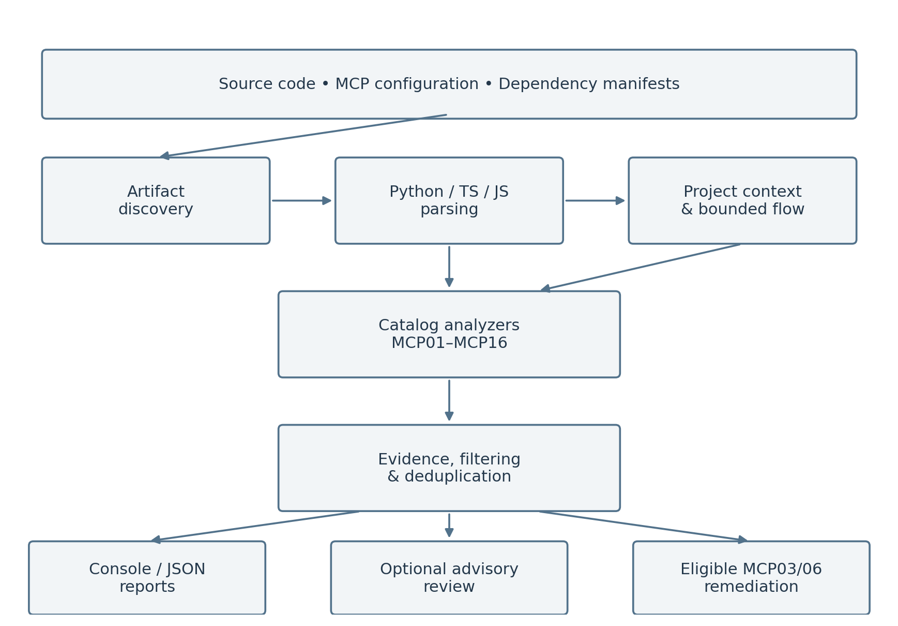
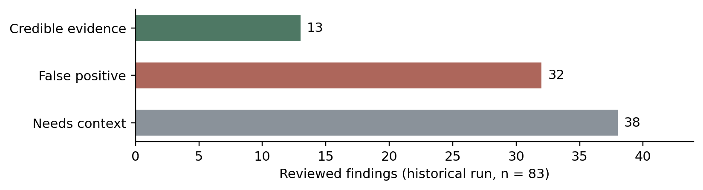
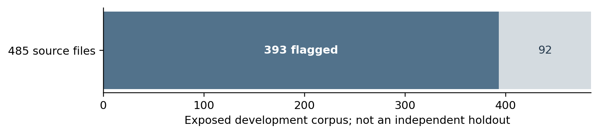
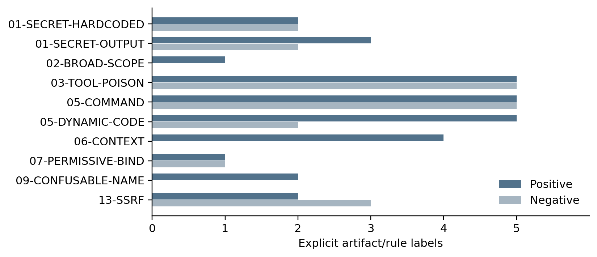

# Static Security Analysis of Model Context Protocol Servers

MCP Security Scanner

Final Project Book

Submitted by

Bar David

Noam Ben Lulu

Supervisor

רועי מטרני

B.Sc. in Electrical and Computer Engineering

Technion – Israel Institute of Technology

Submission date: 21 October 2026

Implementation and validation snapshot: 11 October 2026

<!-- PAGE -->
# Table of Contents

| Chapter | Page |
| --- | ---: |
| Abstract | 3 |
| Model Context Protocol: Background | 4 |
| Static Analysis and MCP Parsing | 6 |
| Security Catalog and Detection Model | 7 |
| Installation and Operation Guide | 11 |
| Evaluation Framework | 14 |
| System Architecture | 17 |
| Project Implementation | 18 |
| Statistics and Validation Results | 27 |
| Conclusions | 33 |
| Bibliography | 34 |

This book follows the chapter sequence and page allocation of the supplied NSSL example: abstract, platform background, core mechanisms, installation, experimental tooling, system diagram, implementation, statistics, conclusions and references. The technical subject has been replaced with the MCP security scanner.

Evidence convention: “historical” refers to preserved evaluation exports, principally from 10 August 2026. “Current” refers to the repository inspection and validation performed on 11 October 2026. “Proposed” identifies work that has not been completed. A measured result is never inferred solely from a design document or an upstream benchmark claim.

The companion DATA_AUDIT.md and its CSV/JSON ledgers contain the complete inventory. NEW_DATA_RESEARCH.md contains acquisition details, source links and proposed extensions. Those supporting records allow the compact statistics chapter to be independently checked.

<!-- PAGE -->
# Abstract

The Model Context Protocol connects AI applications to tools and external information through a common interface. This improves interoperability but also creates a security boundary: an assistant can receive untrusted tool descriptions, invoke privileged operations and consume content supplied by external systems. A malicious description can influence tool selection before any tool is executed, while an otherwise useful tool can expose credentials or return adversarial content.

This project implements a static security scanner for MCP projects. Version 2.0.0 uses a versioned catalog, 2026.1, with 16 categories and 25 stable rules. It analyzes Python, common TypeScript/JavaScript registration patterns, configuration files and dependency manifests. Python AST extraction, bounded source-to-sink analysis and a project security graph provide structured evidence. An optional constrained language-model reviewer adds advisory judgments without removing deterministic findings. Automatic source remediation is restricted to selected tool-poisoning and indirect-prompt-injection findings.

The preserved main evaluation covers ten targets from eight pinned repositories: 566 supported artifacts and 398 recognized tools. Of 83 reviewed findings, 13 identify credible risky evidence, 32 are false positives and 38 require additional context. Precision among conclusive labels is 28.9%; overall recall and false-positive rate cannot be established from finding-only labels. A separate exposed MCPTox experiment flags 393 of 485 source files, which is a development result rather than an independent generalization estimate.

Current validation passes all 59 unit tests, but completes only nine of ten primary targets. A valid annotation without an assigned value triggers an AST data-flow exception in the FastMCP examples. This discrepancy demonstrates why regression tests and external validation are complementary. A staged set of 33 artifacts carries 50 rule labels, but has not been frozen or scored as a final holdout. The project therefore delivers an implemented analysis system and a reproducible validation foundation, with explicit remaining work on robustness, false positives and independent evaluation.

<!-- PAGE -->
# Model Context Protocol

## General overview

MCP provides a common way for an AI host to communicate with external servers. A host manages the application and model interaction; a client handles a server connection; a server exposes capabilities such as tools, resources and prompts. Tool discovery makes names, descriptions and input schemas available to the host, after which a model-assisted workflow may request a tool invocation. The original project was motivated by the security landscape described in the supplied research paper [1].

For a security scanner, the distinction between discovery and execution is essential. A description is natural-language data, yet it can resemble an instruction addressed to the model. Tool poisoning targets this ambiguity. A server may also offer an ordinary description while implementing dangerous behavior, so a metadata-only inspection cannot cover the whole problem.

## Trust boundaries in a tool workflow

Consider a legitimate weather tool. Its input schema accepts a city, its implementation sends a request to a fixed weather service, and its output returns selected forecast fields. Several different security questions arise: whether credentials are exposed, whether the input can change the destination host, whether returned text is treated as untrusted, and whether the deployed endpoint requires authorization. Each question needs different evidence.

The scanner represents these questions as stable rules rather than a single “malicious server” classification. A legitimate application can contain a risky implementation, and a warning can be deployment-dependent. The same file can therefore receive findings in multiple categories without implying multiple confirmed exploits.

## Project boundary

The tool reads artifacts from disk and reports evidence; it does not connect to the target server or execute its tools. This makes source review practical before installation. It also limits what can be concluded about runtime permissions, remote content, user consent and actual exploit success. These limitations are part of the evaluation model, not exceptional cases to discard.

<!-- PAGE -->
# MCP Background — Security Context

## Local and networked servers

Local stdio operation and network deployment create different exposure assumptions. A local process inherits the permissions and environment of its launcher. A network service adds remote identity, authorization, transport and session concerns. The mere presence of HTTP client code does not prove that a file implements an exposed MCP server; it may only call another service.

This distinction explains several historical false positives. A weather client with a fixed upstream endpoint should not be treated as an arbitrary-destination SSRF sink. A helper module mentioning an authorization header should not automatically be treated as an unauthenticated server. The scanner attempts to resolve such questions using registration evidence and linked project context.

## Threat scope

The local catalog combines OWASP-inspired MCP01–MCP10 categories with six additional project categories derived from MCP guidance [2, 3]. MCP11–MCP16 are this project's extensions, not a claim that OWASP publishes a sixteen-item list. Rule and category identifiers are pinned in catalog version 2026.1 even if external guidance evolves.

The principal adversarial inputs are tool metadata, tool parameters, external content, server configuration and dependency declarations. Relevant assets include credentials, local files, privileged processes, internal services and user/session context. The analysis looks for source-visible precursors at these boundaries.

## Security properties and limitations

A static warning can establish that user-controlled data reaches a command expression, but not necessarily that an attacker can exploit the deployed service. Conversely, an absent warning does not establish that a server is safe. Dynamic loading, reflection, generated code, remote payloads and application-specific controls can defeat a bounded static model.

The reporting language therefore distinguishes evidence, confidence and severity. Severity concerns the possible impact of the rule. Confidence concerns the strength of observed support. Human review remains necessary where deployment or trust assumptions determine whether the reported precursor is relevant. The evaluation retains a separate Needs context label for that reason.

<!-- PAGE -->
# Static Analysis and MCP Parsing

## From source files to tools

The scanner first discovers supported artifacts, then extracts a common representation of MCP tools. Python uses the standard-library abstract syntax tree. Decorator-based registration, including common FastMCP styles, identifies tool functions and their docstrings. A low-level adapter recognizes tool declarations in list-tools handlers and links them to dispatch branches in call-tool handlers.

The common tool representation stores names, parameters, descriptions, registration style, declaration and implementation locations, source text and an implementation AST when available. Separating declaration from implementation is important: a tool may be described in one construct and executed through a later dispatcher.

## TypeScript and JavaScript

The additional parser recognizes common SDK registration forms and named handlers. It is a bounded structural parser, not a complete compiler front end or type system. Support for familiar patterns should therefore be measured against actual examples rather than assumed for arbitrary JavaScript or TypeScript syntax.

Parser coverage is distinct from security detection. A file counted as scanned may contain no extracted tools. A tool counted as analyzed may still contain a flow unsupported by an analyzer. Results should record artifact counts, tool counts, parsing failures and rule outcomes separately.

## Source-to-sink reasoning

For command and network risks, the useful question is whether an untrusted source reaches a sensitive sink. Local assignments, formatting, aliases and selected helper calls can preserve that relationship. Recognized validators and fail-closed guards can supply protection evidence. These summaries are deliberately limited; naming a function “validate” does not prove that its implementation is sound.

The project security graph supplements file-local analysis with definitions, calls, imports and authentication evidence. It improves context while retaining deterministic findings that a reviewer can inspect. No part of this process requires importing a third-party server module.

<!-- PAGE -->
# Security Catalog and Detection Model

## Catalog organization

Catalog 2026.1 defines 16 categories and 25 stable rule IDs. Categories support broad reporting; rules identify the specific behavior being checked. The mapping is implemented in mcp_scanner/catalog.py, which is the source of truth for this book. Historical design documents describe the earlier two-category prototype.

| Category | Scope | Rule suffixes |
| --- | --- | --- |
| MCP01 | Secrets and tokens | SECRET-HARDCODED; SECRET-OUTPUT |
| MCP02 | Excessive privilege | BROAD-SCOPE |
| MCP03 | Tool poisoning | TOOL-POISON |
| MCP04 | Supply-chain precursors | MUTABLE-DEPENDENCY; INSTALL-HOOK |

## Metadata, credentials and dependencies

MCP01 checks visible secret-like literals and potential disclosure through output or logging. A variable named token is not itself a secret; false positives can arise when a heuristic confuses a placeholder, property name or masked representation with a credential. Report evidence must redact sensitive values even when they are relevant to a finding.

MCP02 covers broad or administrative scope declarations. Whether a broad scope is justified depends on application requirements. The rule identifies a review point rather than establishing a complete authorization policy.

MCP03 analyzes tool metadata for attempts to redirect model behavior. Obvious markers are useful signals, but benign operational guidance, URLs and file descriptions need careful handling. Multiple signatures can describe one poisoned description and must not be counted as independent attack examples.

MCP04 concerns mutable dependencies and dangerous install hooks. A known-vulnerable but exactly pinned package is a different property from an unpinned dependency. This scanner is not presented as a comprehensive CVE database, and the evaluation must not equate those two labels.

<!-- PAGE -->
# Security Catalog — Execution and Content

| Category | Scope | Rule suffixes |
| --- | --- | --- |
| MCP05 | Command/code execution | COMMAND-INJECTION; DYNAMIC-CODE |
| MCP06 | Untrusted model context | UNTRUSTED-CONTEXT |
| MCP07 | Authentication/authorization | MISSING-AUTH; PERMISSIVE-BIND |
| MCP08 | Auditability | MISSING-AUDIT |

## Execution risks

MCP05 combines sink recognition with bounded flow reasoning. An unsafe example is an input parameter incorporated into a shell command. A superficially similar expression, such as a JavaScript regular expression's exec method, is not the same sink. Negative examples must cover these lookalikes to avoid measuring only easy positives.

The dynamic-code rule covers selected evaluator patterns. The fact that a program can execute code does not establish that all uses are unauthorized; the source of the executed value and application boundary matter.

## Untrusted content

MCP06 examines external content returned through tools. File contents, HTTP responses, database text and process output can carry instructions that the host should treat as data. The original detector identifies risky returns and selected transformations. It cannot prove that arbitrary natural-language content has become harmless merely because a sanitizer was called.

## Identity and observability

MCP07 asks whether a network server has visible authentication/authorization evidence, including protections in linked modules. Imported authentication code without enforcement is insufficient. Conversely, file-local absence is weak evidence when an application relies on middleware, a proxy or an external identity layer.

MCP08 identifies sensitive operations without visible audit telemetry. A local source file may omit logging because a shared service provides it. This is another reason to retain context-dependent results rather than force every warning into a definitive vulnerability/clean judgment.

Automatic remediation remains restricted to selected MCP03 and MCP06 findings. The categories on this page do not all receive automatic fixes.

<!-- PAGE -->
# Security Catalog — Context and OAuth

| Category | Scope | Rule suffixes |
| --- | --- | --- |
| MCP09 | Unmanaged/confusable registrations | UNMANAGED-SERVER; CONFUSABLE-NAME |
| MCP10 | Context isolation and disclosure | SHARED-CONTEXT; OVER-SHARING |
| MCP11 | OAuth proxy consent | CONFUSED-DEPUTY |
| MCP12 | Token audience separation | TOKEN-PASSTHROUGH |

## Registration boundaries

MCP09 includes unmanaged startup registrations and confusable tool names. Two standalone tutorial applications can legitimately use the same tool name. A meaningful collision analysis needs the application's registration boundary, not simply a directory containing many unrelated examples.

The historical evaluation helped identify this source of false positives. Current code avoids treating identical names in independent files as automatically confusable, but application-root inference remains a limitation for more complex layouts.

## Shared state and disclosure

MCP10 addresses inappropriate context sharing and sensitive output. The distinction between mutable user data and a global configuration constant is essential. A cache time-to-live value can be process-wide without exposing user data. Historical labels show that global-state heuristics remain a major precision problem.

## OAuth-specific risks

MCP11 models a proxy acting with insufficient per-client consent. MCP12 concerns inappropriate forwarding or acceptance of inbound bearer credentials. These project categories are motivated by the MCP security guidance [3], but the implemented rules use bounded evidence rather than a complete protocol verifier.

For validation, construct matched cases with and without the specific protection. A label such as “uses OAuth” is too coarse. The evaluator must establish where consent is enforced, how identity is bound to state, and whether the source-visible behavior falls within the scanner's supported analysis. If these facts cannot be determined, the correct label is unknown or Needs context, not an invented negative.

<!-- PAGE -->
# Security Catalog — Network and Lifecycle

| Category | Scope | Rule suffixes |
| --- | --- | --- |
| MCP13 | Network destination control | SSRF; METADATA-SSRF |
| MCP14 | Session security | WEAK-SESSION; SESSION-AUTH |
| MCP15 | Authorization URL handling | UNSAFE-AUTH-URL |
| MCP16 | Local startup/proxy execution | DANGEROUS-STARTUP; ARBITRARY-SPAWN |

## Destination-aware analysis

An HTTP call containing a tool parameter is not automatically SSRF. The relevant question is whether that parameter can control the destination. A constant host with a user-selected query differs from an arbitrary input URL. The implementation tracks the actual destination argument and selected helper flows to reduce this ambiguity.

In the historical reference Fetch target, the recorded evidence follows arguments through intermediate variables to a network helper's destination. This is useful evidence for MCP13. It is not equivalent to a demonstrated exploit against a deployed service.

## Session and process boundaries

MCP14 concerns predictable or improperly bound session state. MCP15 identifies unsafe handling of authorization URLs. MCP16 covers local startup and stdio-proxy behavior that may execute commands influenced by an untrusted party. These checks have less independent validation data than the original MCP03/MCP06 detectors.

## Interpreting a finding

A report connects a stable rule to a location, explanation, severity, confidence and remediation recommendation. Structured evidence can include a source, sink, path, observed protections and missing protections. Multiple findings may be valid observations about one implementation, while overlapping signatures may describe one underlying cause.

A catalog entry demonstrates implemented scope, not measured detection coverage. The staged evaluation set currently labels only ten of the twenty-five rules. Broad claims about all sixteen categories would therefore exceed the available empirical evidence. The statistics chapter reports these coverage gaps explicitly.

<!-- PAGE -->
# Installation and Operation Guide

## Development environment

The scanner's core uses Python's standard library and runs directly from a checkout. No installation step is required for normal development. The optional requirements file documents ancillary dependencies. Python 3.13 was used for the current validation snapshot; this observation is not a claim that every earlier Python 3 release supports the code's syntax and APIs.

Run commands from the repository root to ensure that the checked-out package is used:

```powershell
python --version
python -m mcp_scanner rules
python -m mcp_scanner scan tests\samples\clean_server.py
```

The rules command lists the versioned categories and stable identifiers. The clean fixture gives a quick end-to-end check without requiring network access or a running MCP server.

## Repository areas

| Directory | Purpose |
| --- | --- |
| mcp_scanner | Scanner implementation, CLI, reporters and fixer |
| tests | Unit/integration tests and local sample servers |
| evaluation | Pinned corpus metadata, scripts, labels and historical reports |
| evaluation/holdout | Candidate provenance and staged rule labels |
| deliverables | Book, inventory ledgers, research and fresh validation |

Third-party repositories are treated as source data. Downloading a repository does not require installing its dependencies or running its server. The experimental workflow keeps source acquisition separate from execution.

## Reproducibility

Record the scanner revision, corpus revision, configuration, exact command and environment for each formal evaluation. Catalog version alone is insufficient because implementation changes can occur without changing rule IDs. Generated results should be stored outside the target tree so they cannot become future scan inputs.

<!-- PAGE -->
# Operation Guide — Scanning and Reporting

## Common scan commands

```powershell
python -m mcp_scanner scan path\to\server.py
python -m mcp_scanner scan path\to\project --format json
python -m mcp_scanner scan path\to\project --check MCP13
python -m mcp_scanner scan path\to\project --check MCP03-TOOL-POISON
python -m mcp_scanner scan path\to\project --review none
```

A category filter and a rule filter answer different questions. For example, filtering to MCP03 can test metadata-poisoning behavior, but zero results from that run says nothing about authentication or command injection. Preserve the complete command alongside the output.

## Exit codes

| Code | Meaning |
| --- | --- |
| 0 | Scan completed without reported findings |
| 1 | Scan completed and findings were reported |
| 2 | Handled scan/configuration error |

An exit code of 1 is expected for intentionally vulnerable fixtures. A test harness should not treat it as a command failure. Unhandled exceptions must also be recorded as failures; they are not clean scans and should not be converted into ordinary findings.

## Reading output

The console report supports interactive review. JSON provides structured evidence for an evaluation script or external integration. The reporter module also contains SARIF support; the public CLI options should be checked rather than assuming every reporter method is exposed as a command-line format.

Review the rule, source location and evidence before accepting a warning. A high-severity category can still have weak or contextual evidence. A file count indicates processed artifacts, not detected MCP servers. Configuration and manifest files contribute to artifact counts even when they define no tools.

Current CLI smoke checks return 0 for the clean sample and 1 for the poisoned sample. These checks exercise command-line behavior, while the full corpus run exposes a separate unhandled data-flow exception.

<!-- PAGE -->
# Operation Guide — Remediation and Review

## Targeted automatic remediation

```powershell
python -m mcp_scanner fix path\to\server.py --dry-run --verbose
python -m mcp_scanner fix path\to\server.py --verify
```

Preview changes before applying them. Eligible MCP03/MCP06 findings can produce localized source transformations. Ambiguous findings remain for manual review, and the other categories remain report-only. Verification separates remaining fixable-category findings from risks that the fixer intentionally does not modify.

The mechanical acceptance properties are valid Python syntax, unchanged bytes during a dry run, a backup when requested, and idempotence. These properties prevent repeated or malformed edits; they do not establish full semantic equivalence or immunity to arbitrary prompt injection.

## Optional semantic review

```powershell
python -m mcp_scanner scan path\to\project --review llm --review-limit 10
```

The current implementation requires an API credential supplied through the environment. Credentials should never be pasted into reports. Review transmits a redacted, bounded excerpt and selected project context to an external model. Deterministic analysis remains the origin of the finding; review verdicts are supplementary metadata.

Stored review responses are cached. During this audit, no new paid review request was made. Existing pilot exports are analyzed as historical artifacts and are not confused with a current reviewer experiment.

## Development checks

```powershell
python -m unittest discover -v
python deliverables\audit_data.py
python deliverables\validate_primary.py
```

The audit command inventories records without scanning staged data. The validation command reads only the already-used primary corpus and records target-level failures. The separate holdout runner has a deliberate one-time lifecycle and should be used only after the final evaluation set and scanner configuration are fixed.

<!-- PAGE -->
# Evaluation Framework

## Different kinds of data

The folder contains development fixtures, real project snapshots, synthetic attacks, runtime benchmarks, scanner outputs and candidate labels. These units are not interchangeable. A repository can contain many files; a file can contain many tools; one poisoned tool can trigger multiple signatures.

The preserved primary manifest identifies eight public repositories and ten target subdirectories. Exact revisions make the source acquisition reproducible. Reports and labels are stored separately, allowing a distinction between what was scanned and what was actually reviewed.

## Data roles

| Data role | Present evidence | Appropriate use |
| --- | --- | --- |
| Local regression fixtures | Six sample files plus inline test cases | Fast development checks |
| Primary real-world corpus | Ten targets with historical labels | Precision/error analysis on exposed data |
| External benchmarks | Downloaded source, metadata and runtime records | Development or adapter research |
| Staged evaluation set | 33 artifacts, 50 rule labels | Candidate independent evaluation |
| Newly researched sources | 115 text snapshots from six repositories | Additional candidate labeling |

## What “training” means here

The deterministic scanner has no implemented model-fitting process. Patterns, data-flow summaries and parser behavior are engineered using examples. This is detector development and tuning, even if informally called training. The optional model reviewer performs inference with a pre-existing model; the records do not show a fine-tuning dataset or training run.

This distinction matters statistically. A corpus used to inspect misses and refine patterns becomes development data. Improved detection on the same corpus is useful evidence of progress, but it cannot serve as an unbiased estimate of performance on unseen projects. The final evaluation needs independent source families and a locked configuration.

<!-- PAGE -->
# Evaluation Framework — Protocol

## Acquisition and provenance

Each primary target is tied to a repository, full revision and subdirectory. Candidate artifacts additionally carry file hashes and explicit rule labels. Source acquisition does not execute third-party tools. The newly researched artifacts are saved as text snapshots with original URLs, paths and SHA-256 hashes.

The staged label unit is an artifact/rule/polarity tuple. A positive label means the exact reviewed property is present. A negative label means that property was reviewed and found absent. An unlabeled rule is unknown, not an implicit negative. Whole-repository “benign” labels are therefore insufficient for scoring every rule.

## Preventing leakage

First group related artifacts by upstream repository, common example family and vulnerable/fixed pair. Then deduplicate exact and normalized source variants. Split these groups before using detector outputs to choose examples. Randomly splitting individual near-duplicate files can make performance look better without testing generalization.

The existing workflow is staging, freeze, acquire, issue a one-time token, run, then score. However, the current manifest remains in staging. No frozen manifest or final holdout results were found. An older MCPSafety file named “holdout” contains scan results and must be treated as previously exposed material.

## Independent review

For the final experiment, two reviewers should assign labels from source and provenance, resolve disagreements, and record rationale and scope. This is a proposed improvement; the historical CSV does not demonstrate two-person annotation or inter-rater agreement.

An evaluation harness must preserve unsupported syntax and scanner failures rather than silently dropping them. It should also distinguish a metadata adapter from native source analysis. Converting a JSON description into a fabricated server may be useful experimentally, but changes the task and cannot be reported as scanning the original implementation.

<!-- PAGE -->
# Evaluation Framework — Measurements

## Classification measures

| Measure | Definition | Required evidence |
| --- | --- | --- |
| Precision | TP / (TP + FP) | Reviewed positive predictions |
| Recall | TP / (TP + FN) | Exhaustively labeled positives |
| False-positive rate | FP / (FP + TN) | Explicit negative units |
| Contextual rate | Contextual / reviewed predictions | Separate contextual labels |
| Completion rate | Completed targets / attempted targets | Failure-preserving run ledger |

For this project, the historical conclusive precision is 13/(13+32), or 28.9%. The 38 contextual labels are excluded by definition. No exhaustive negative or missed-positive census exists for that corpus, so FPR, recall and accuracy cannot be recovered from its finding labels.

## Choosing the unit

Finding-level precision and artifact-level detection answer different questions. MCPTox produces 1,107 warnings across 393 flagged files; the file-level numerator is 393, not 1,107. Likewise, fifty staged labels do not mean fifty independent source files. A complete report states the prediction unit, label unit and deduplication policy before presenting a percentage.

## Uncertainty and useful negatives

Zero false positives in a small clean set is encouraging but inconclusive. For approximately independent binary negative cases, zero in 100 leaves a one-sided 95% upper bound near 3%, using 1 minus 0.05 raised to the power 1/100. Closely related fixtures provide less information than independent examples.

The final negative set should therefore include legitimate file/URL/shell descriptions, quoted attack text, regex execution, fixed-origin requests, real authentication enforcement and benign global constants. Positive counterparts ensure that avoiding false positives has not disabled useful detection. Results should be broken down by rule and language, with contextual decisions, parsing coverage and failed targets reported separately.

<!-- PAGE -->
# System Architecture



Figure 1. Deterministic source-analysis pipeline and optional advisory review.

The input boundary accepts source files, configuration and dependency manifests. Discovery selects artifacts and passes them to language-specific parsing or artifact analyzers. Python and TypeScript/JavaScript parsers produce a shared tool representation. The security graph supplies bounded definitions, calls and authentication context.

Analyzers generate candidate findings against the stable catalog. Evidence collection records relevant source-to-sink relationships and observed protections. Filtering and deduplication produce the reportable finding set. Console and JSON reporters present the same underlying deterministic decisions.

The reviewer is an optional branch after findings exist. It receives selected redacted evidence and adds an advisory verdict; it cannot suppress the original finding or execute the target. The fixer is a separate, limited action path for eligible MCP03/MCP06 source changes, with dry-run and verification behavior.

Evaluation surrounds the pipeline with pinned inputs, recorded configuration, labels and metrics. It must also record failure to complete. Neither a warning-free report nor a successful unit suite proves that the entire input space has been analyzed correctly.

<!-- PAGE -->
# Project Implementation

## Module organization

| Module | Responsibility |
| --- | --- |
| main.py | Argument parsing and scan/fix/rules commands |
| scanner.py | Artifact orchestration and ScanResult |
| catalog.py | Category names, version and stable rule IDs |
| parsers | Python AST and bounded TS/JS tool extraction |
| analyzers | Metadata, content and project-risk checks |
| dataflow.py / security_graph.py | Flow summaries and linked project context |
| evidence.py / reporters | Structured evidence, redaction and output |
| fixer.py / defenses | Targeted transforms and sanitization |
| reviewer.py | Optional bounded semantic review |

## Orchestration

MCPScanner coordinates discovery, parsing and analysis. ScanResult separates findings from artifact counts, tool counts, server counts and parse errors. This structure lets an evaluator ask whether the scanner understood the target before interpreting its warning count.

Directory scans combine local analysis with project context. Single-file scans cannot always provide the same cross-module evidence. The target boundary is therefore part of the experiment: scanning a whole framework's examples as one application can create misleading context, while scanning isolated files can lose genuine protections.

## Stable interfaces

The category/rule catalog supports filtering and external consumers. Keeping identifiers stable allows comparison across runs, but a rule ID alone does not identify the implementation version. Formal evaluation also needs a scanner commit and input hashes.

The current implementation was inspected directly for this book. Historical planning notes are used only to describe motivation; they are not used to claim features absent from the code. The original MCP03/MCP06 prototype has grown into a broader project scanner, while those two categories retain the only automatic remediation path.

<!-- PAGE -->
# Implementation — Tool Extraction

## Python registration styles

Decorator extraction recognizes supported tool decorators and avoids treating arbitrary substring matches as registrations. The parser associates function parameters, metadata and implementation source with each tool. Docstrings are natural-language input to MCP03 analysis, while implementation bodies support content and execution checks.

Low-level MCP APIs need a different strategy. Tools declared through list-tools handlers are linked to call-tool dispatch branches, including supported if/match and static/enum naming patterns. This allows metadata and implementation evidence to share one representation even when no decorated tool function exists.

## Observed coverage

The historical official Fetch, Git and Time targets expose one, twelve and two recognized tools respectively. That result demonstrates support for these particular low-level examples. It does not establish complete coverage of all dispatch idioms.

The independent historical inventory counts 379 attribute-decorated tools, six list/call handlers and 58 explicit Tool constructors. These are overlapping structural measurements, not values to add into a total tool count. The scanner's total of 398 tools also includes low-level registrations and accepted bare decorators.

## Script parsing

Common TypeScript/JavaScript SDK patterns are handled by a dedicated structural parser. Tests cover named handlers, low-level registration, parameter-to-sink patterns and command-lookalike negatives. Unrecognized constructs should be treated as coverage limitations rather than negative vulnerability labels.

## Important failure mode

Valid syntax does not guarantee that every analyzer handles the resulting AST node shape. The current corpus failure occurs after parsing: a valueless annotated assignment reaches data-flow analysis. Separating parser success from analyzer success makes that distinction visible and provides a precise regression target.

<!-- PAGE -->
# Implementation — Data Flow and Context

## Bounded taint propagation

The data-flow layer follows tool parameters through selected expressions, assignments and helper summaries. It records the originating input and sensitive operation. Local helper summaries use a bounded fixed-point process; this is a practical approximation rather than whole-program verification.

A destination-aware SSRF check analyzes the value passed as a network destination. It avoids tainting an entire request simply because some other argument contains user data. A fixed upstream host with a user-controlled query can then differ from a fully controlled URL.

## Protection evidence

Recognized sanitization/validation functions and fail-closed allowlist guards can stop propagation or appear as protection evidence. Guard ordering matters: a check after execution cannot protect an earlier sink. The unit suite includes this distinction.

The recognizers remain heuristic. A function name suggesting validation is not proof of correct semantics. A complete validation result would need to establish that all relevant paths enforce the required property, including redirects, helper behavior and exceptional control flow.

## Project security graph

The graph stores import relationships, symbol definitions, call sites and authentication-related evidence. It distinguishes mentioning or importing authentication from visibly enforcing it in supported patterns. It also supplies bounded context to the optional reviewer.

Cross-file analysis improves evidence quality, but application boundaries and external middleware can remain unresolved. A scanner should not invent authentication just because a similarly named symbol exists elsewhere in a repository. Conversely, file-local absence alone is not strong proof that a deployment is unauthenticated. These cases motivate confidence levels and the evaluation's contextual label.

<!-- PAGE -->
# Implementation — Project Risk Analysis

## Source, configuration and manifests

ProjectRiskAnalyzer covers the catalog beyond the two original detectors. Depending on the artifact, it examines AST structure, script patterns, configuration fields or dependency declarations. Findings retain a common reporting model even though the underlying evidence differs.

Configuration analysis can identify unmanaged executable registrations or broad scopes. Manifest analysis can identify mutable versions and risky install behavior. Source analysis can connect tool inputs to process or network operations and inspect identity, session and context patterns.

## Controlling false positives

The project includes targeted exclusions for benign cases found during real-world evaluation: Python compatibility metadata should not become an unpinned dependency; a documentation link should not become an executable registration; a client/helper module should not automatically imply an exposed unauthenticated server.

These refinements require paired tests. A negative example demonstrates that the exclusion removes an incorrect warning, while a positive counterpart checks that the intended dangerous pattern remains detectable. Broad pattern changes without such comparisons can produce an apparently clean report by weakening the detector.

## Evidence and redaction

Evidence should explain why the rule fired without reproducing secrets. The scanner's finding/report path includes redaction of secret-like values. That property is especially important when reports are attached to a degree submission, stored in Git or sent to an optional reviewer.

The current inventory also identifies an input-hygiene gap: generated reviewer cache JSON can be rediscovered as target artifacts. This is an implementation defect relative to the repository's design constraint, and it explains a change in artifact counts. A reproducible pipeline must separate inputs from generated outputs, not only redact their contents.

<!-- PAGE -->
# Implementation — Metadata and Content Checks

## Tool-poisoning analysis

The MCP03 analyzer inspects metadata for attempts to influence the assistant beyond the declared tool's purpose. Examples include unrelated prerequisites, forced argument changes, overrides and concealed instructions. Supporting signals such as URLs become more meaningful when primary poisoning evidence is present.

Legitimate instructions must also be represented in the tests. An honest description can explain how to read a file, use a shell tool or supply a required parameter. Treating all imperative language as malicious would make the scanner unusable on normal tools.

## Indirect content risks

The MCP06 analyzer examines external data returned by supported tool implementations. Raw text from HTTP, files, databases or subprocesses can become model context. The finding is a risky trust-boundary precursor, not proof that every returned document contains an attack.

Sanitization helpers normalize content, remove selected active or suspicious elements, limit size and make untrusted-data boundaries explicit. These are defensive measures, but natural-language adversarial content is not fully characterized by a finite pattern list.

## Local controls

Three evaluation fixtures provide a focused functional check: a clean arithmetic tool, a tool-poisoning mutation and an untrusted-content mutation. Historical results show zero warnings on the clean fixture, four overlapping MCP03 signatures on the poisoned description, and MCP06 plus MCP13 on the network-content mutation.

The correct claim is that these controlled cases exercise intended behavior. Two injected positive cases cannot estimate general recall, and a single clean fixture cannot estimate the real-world false-positive rate. External benign examples with realistic vocabulary are needed to test whether metadata heuristics distinguish malicious direction from ordinary documentation.

<!-- PAGE -->
# Implementation — Targeted Remediation

## Eligibility and source transforms

The fixer intentionally has a narrower scope than the detector catalog. Only eligible, high-confidence MCP03 and MCP06 findings can result in automatic changes. The remaining categories stay report-only because resolving them can require application-specific policy, deployment knowledge or architectural changes.

For metadata poisoning, a safe transformation attempts to remove the targeted malicious portion while retaining a valid tool definition. For untrusted content, a supported transformation can introduce the project's defensive handling. Ambiguous source locations or unsafe transformations should remain manual work.

## Mechanical validation

The remediation workflow supports a dry run, backup creation and post-change verification. A successful dry run leaves bytes unchanged. Applied output must remain valid Python. A second application should not continue changing already-fixed code. These properties are covered by local tests and historical fixture experiments.

Verification reports the two fixable categories separately from other risks. For example, adding a content boundary does not necessarily remove a tool-controlled network destination. An MCP13 finding may remain even when the MCP06 transformation succeeds.

## Evaluation evidence

Historical fixture records show successful dry runs and apply/verify operations, valid syntax, created backups and idempotence for both controlled mutations. No canonical third-party corpus source was used as a destructive remediation target. Disposable copies isolate experiments from pinned inputs.

This evidence supports the engineering reliability of those transformations on the tested cases. It does not prove that every accepted rewrite preserves all application behavior, nor that any sanitizer can eliminate arbitrary prompt injection. The final project evaluation should retain these limitations and report manual-review cases rather than silently treating them as automatic successes.

<!-- PAGE -->
# Implementation — Reports and Evaluation Records

## Finding structure

A finding records its rule/category, severity, confidence, location, explanation and recommendation. Optional structured evidence adds sources, sinks, paths and protections. Fixability indicates whether the finding is eligible for the restricted remediation flow; it is not a statement that all findings in a category can be safely rewritten.

## Deduplication

Multiple analyzer paths can identify the same issue. Deduplication limits redundant reporting, but warning counts still differ from defect counts and example counts. The controlled poisoned docstring illustrates this: four signatures are evidence for one mutated tool, not four independent attacks.

The data audit therefore uses separate ledgers for repository inventory, scan exports, finding labels, staged rule labels and benchmark record containers. Exact source hashes detect byte-level duplication; source families and adapted benchmark copies require additional semantic review.

## Linking labels to reports

Historical labels include target and finding index. An index can shift when detector behavior changes. The semantic-review audit instead links labels through the original report to target, normalized path, rule and source line. That is more stable, but still not a substitute for a complete source fingerprint.

For future runs, record immutable input identity and finding identity directly. A complete run manifest should contain scanner commit, source revisions/hashes, command arguments, environment, all processed paths and target failures. This would allow an exact comparison of changed findings and remove ambiguity about whether an unflagged artifact was actually analyzed.

The current book preserves the older labeled result and the new partial validation as separate experiments. It does not transfer historical labels or precision to the current warning set without review.

<!-- PAGE -->
# Implementation — Optional Semantic Review

## Constrained advisory role

The reviewer starts from a deterministic finding. It receives a bounded redacted excerpt and precomputed read-only project context such as related definitions, callers and authentication evidence. Source comments and strings are treated as untrusted input. The review path provides no arbitrary command execution, code editing or target-network access.

The implementation requests structured verdicts and stores the result as metadata. Review never removes or changes the original deterministic warning. API/output failures produce insufficient-evidence outcomes so that the underlying scan remains inspectable.

## Caching and versioning

Cache identity includes information about the model, prompt, finding and source. This can avoid repeat requests during development, but exported cached appearances must not be counted as independent review experiments. The historical pilot exports contain eighteen appearances of sixteen distinct finding/model/prompt identities.

Current source uses prompt version 2026.1-review-2. Saved pilots use review-1. Their agreement results therefore evaluate an earlier configuration, not the current implementation. No new review request was made for this book.

## Measuring usefulness

The relevant questions are whether review agrees with independent labels, whether it endorses false positives, whether it misses credible evidence, and how often it abstains. A confident explanation is not itself validation. In one stored example, a process-wide cache TTL constant was endorsed as a shared-context risk despite the historical human FP label.

The current pilot is too small and unbalanced to demonstrate reliable improvement: only one unique reviewed finding has a human TP label. The statistics chapter reports agreement and abstention-related outcomes without claiming a deployment-ready classifier or reduced scanner false-positive rate.

<!-- PAGE -->
# Implementation — Verification Strategy

## Regression suite

The current unittest suite contains 59 tests: 44 scanner tests, five reviewer tests, five holdout-workflow tests, three CLI tests and two fixer tests. They cover catalog behavior, parsing, selected taint paths, benign exclusions, redaction, review caching/failure handling, CLI exits and controlled remediation.

The reviewer tests use mock transport, so running the suite does not require a paid model request. The holdout tests exercise synthetic lifecycle data, not the reserved corpus itself.

## External validation

Unit tests check known expectations. Real-world targets expose syntax, application organization and state combinations that developers may not anticipate. This book therefore adds a fresh run over the already-exposed primary corpus, saving results separately from historical exports and recording each target's failure status.

All 59 tests passed, but the FastMCP target raised an exception in data-flow analysis. This is a concrete counterexample to the claim that a passing suite establishes full scanner robustness. The test suite needs a focused regression for valueless annotated assignments before the next complete corpus run.

## Input hygiene

Existing reviewer caches also enter discovery under the current implementation. The Atlassian target now counts 123 artifacts compared with 117 historically, because six cached JSON files are included. A generated-cache exclusion should be verified through an artifact-level regression.

## Required next checks

The next validation cycle should resolve both defects, rerun the primary corpus, review changed findings and preserve the complete input ledger. Only then should a locked detector be evaluated against a frozen independent set. The current book reports the observed gap explicitly; it does not modify production code or manufacture a successful final holdout result.

<!-- PAGE -->
# Statistics and Validation Results

## Available data

The pre-existing evaluation directories contain 43 checkouts from 42 distinct remotes. Excluding Git internals, selected dependency/cache directories and backups gives 4,741 files totaling 745,416,472 logical bytes, or 710.88 MiB. Of 2,496 source-file copies, 2,365 have distinct byte hashes. These counts include harness/framework code and documents; they are not all labeled examples.

| Inventory area | Checkouts | Files | Source of count |
| --- | ---: | ---: | --- |
| Primary corpus | 8 | 791 | Local working-tree inventory |
| External corpus | 35 | 3,950 | Local working-tree inventory |
| Total existing corpus | 43 | 4,741 | Before new research downloads |

Saved scan reports reference 14 checkout directories, representing 13 remotes. Twenty-nine directories have no matching saved scan report. This establishes recorded use, not proof that the other directories were never inspected.

Selecting one report per non-nested historical target scope produces 1,204 artifact-processing slots: 566 primary and 638 external. Repeated runs are removed from that sum, but shared content and version overlap remain. An exact percentage of independent labeled data used cannot be reconstructed from the available logs.

Large record collections inflate apparent dataset size. AgentDefense-Bench alone has 33,368 consolidated attack entries and 250 benign entries, mostly prompt/runtime-oriented material. The audit records 535 list/row containers across major datasets without summing them into a misleading global sample count.

Six newly researched sources contribute 115 additional text snapshots, kept separate from this baseline inventory. Their provenance is recorded, but they have not yet been assigned final local labels or evaluated.

<!-- PAGE -->
# Statistics — Historical Primary Corpus



Figure 2. Review outcomes for the preserved 83-finding experiment.

| Target | Artifacts | Tools | Findings |
| --- | ---: | ---: | ---: |
| Fetch / Git / Time | 19 | 15 | 1 |
| Python SDK examples | 243 | 117 | 45 |
| Weather quickstart | 3 | 2 | 0 |
| FastMCP examples | 141 | 156 | 20 |
| Atlassian | 117 | 98 | 13 |
| MarkItDown / simple server | 13 | 3 | 1 |
| AWS Documentation | 30 | 7 | 3 |
| Total | 566 | 398 | 83 |

Thirteen findings are labeled credible risky evidence, thirty-two false positives and thirty-eight contextual. Conclusive precision is 28.9%; contextual findings constitute 45.8% of emitted warnings. The TP label evaluates the evidence for a rule, not whole-project exploitability.

The largest warning category is MCP07 with 37 findings, including 34 missing-auth cases labeled Needs context. Remaining false positives cluster in secrets, shared context and OAuth-related heuristics. Exhaustive negatives and missed positives were not labeled, so recall, FPR and accuracy are unavailable.

The older report describes a 238-finding baseline. Its raw export was not located in the audited results, so the historical improvement narrative is not presented here as an independently recomputed paired measurement.

<!-- PAGE -->
# Statistics — External Benchmark Evidence



Figure 3. File-level outcomes in the exposed MCPTox development run.

The local MCPTox def_tool directory contains 485 Python files. The final two preserved runs each emit 1,107 MCP03 warnings across 393 distinct files. Therefore 81.0% of these attack-source files are flagged and 92 are unflagged. The original saved run reports zero findings on the same 485-file scope, demonstrating substantial sensitivity to implementation changes.

This is development performance on an exposed corpus. The records do not justify calling it independent recall, and the 1,107 warnings are not 1,107 detected attacks. The local response file contains 1,348 malicious instances, while the paper describes 1,312 cases [4]; these units and snapshots must not be conflated with the 485 source files.

| Additional recorded scope | Artifacts | Tools | Findings |
| --- | ---: | ---: | ---: |
| MSB attack-tool source | 64 | 267 | 14 |
| MCPSecBench code | 13 | 19 | 16 |
| Excel 0.1.7 / 0.1.8 | 17 / 19 | 25 / 25 | 1 / 2 |
| MCPSafety previously scanned subset | 40 | 156 | 0 |

The MCPSafety filename suggests a clean MCP03 experiment, but the exact invocation was not preserved. Zero warnings cannot establish all-category safety. MSB and MCPSecBench also contain runtime tasks whose success criteria differ from static rule labels [5, 6].

<!-- PAGE -->
# Statistics — Staged Holdout and New Data



Figure 4. Positive and negative rule labels in the staged set.

The manifest contains seven sources, 33 artifacts and 50 labels: 30 positive and 20 negative. Twenty-three artifacts have positive labels and ten have negative labels. All artifact hashes match local copies. The state is staging; there is no frozen manifest or final holdout result.

The labels cover ten of twenty-five rules and eight of sixteen categories. Negative labels cover only seven rules in five categories. MCP06 has four positive labels but no negative labels. Eight categories have no staged labels at all: MCP04, MCP08, MCP10–MCP12 and MCP14–MCP16.

Additional research located two direct source-fixture collections and four metadata/runtime-oriented sources. The direct collections contain eleven source-server fixtures from windshock/mcpscan and seven MCP source fixtures from detonate, including three and one upstream normal/honest controls respectively [7, 8]. These are candidates, not automatically accepted all-rule negatives.

Sentinel supplies forty labeled manifests, including twenty clean ones [9]. The other selected sources add clean tool descriptions, benign near-miss traffic and synthetic business-tool manifests. Adapter requirements, taxonomy differences and exact provenance are detailed in the companion research report. None was scanned or merged into the holdout during this task.

<!-- PAGE -->
# Statistics — Current Validation Snapshot

## Unit and command-line checks

All 59 unittest cases pass. The clean sample returns exit code 0 and the intentionally poisoned sample returns 1. These results validate the tested behaviors, not every real-world input.

## Primary-corpus rerun, 11 October 2026

| Target | Status | Artifacts | Findings |
| --- | --- | ---: | ---: |
| Fetch / Git / Time | Complete | 19 | 1 |
| Python SDK examples | Complete | 243 | 53 |
| Weather quickstart | Complete | 3 | 0 |
| FastMCP examples | Failed | — | — |
| Atlassian | Complete | 123 | 13 |
| MarkItDown / simple server | Complete | 13 | 1 |
| AWS Documentation | Complete | 30 | 3 |
| Completed targets only | 9 of 10 | 431 | 71 |

The nine completed targets contain 242 recognized tools. Their 71 findings have not been relabeled for this configuration, so the historical 28.9% precision cannot be assigned to them.

FastMCP's elicitation.py contains valueless annotations such as favorite_color: str. The data-flow code passes the missing assignment value into ast.walk, causing an AttributeError. The target is a failed analysis, not a clean or vulnerable classification.

Atlassian's artifact count also includes six existing reviewer-cache JSON files because discovery does not exclude .mcp-scanner-cache. This explains the 117-to-123 count change and violates the intended input-hygiene rule. Both defects are documented with separate result files and a traceback; production code was left unchanged during the documentation audit.

<!-- PAGE -->
# Statistics — Review and Remediation

## Historical semantic-review pilot

Four exports contain eighteen review appearances but only sixteen distinct finding/model/prompt identities. Repeated cached exports are not independent experiments.

| Measure | Result |
| --- | ---: |
| Unique review identities | 16 |
| Human labels: FP / Needs context / TP | 9 / 6 / 1 |
| Model verdicts: LIKELY / UNLIKELY / NEEDS_CONTEXT | 5 / 4 / 7 |
| Exact three-way agreement | 9/16 = 56.25% |
| Agreement on decisive, conclusively labeled cases | 5/7 = 71.4% |
| Human-FP cases endorsed LIKELY | 2 |

Only one reviewed case has a human TP label, so the pilot cannot establish reliable missed-risk performance. Advisory verdicts do not suppress deterministic findings, and these results do not demonstrate a reduced scanner FPR. Saved reviews use an earlier prompt version than the current implementation. Cost, latency and token-use records are insufficient for a quantitative efficiency comparison.

## Remediation evidence

Historical controlled MCP03/MCP06 experiments record unchanged dry-run bytes, successful application, valid syntax, backups and idempotence. The current fixer unit tests also pass. This supports mechanical behavior for the tested transformations; general semantic safety and arbitrary prompt-injection resistance remain unproven.

## Readiness assessment

The implementation is substantial and testable, but final independent validation is incomplete. The next required steps are to resolve the corpus crash and cache-discovery issue, relabel a complete current primary run, complete rule-specific negative coverage and consume a frozen final set only after the configuration is locked. These steps are proposed work, not fabricated project results.

<!-- PAGE -->
# Conclusions

The project demonstrates a practical static-analysis approach to MCP security. It combines a stable catalog, multiple input types, Python AST extraction, common script registration support, bounded flow analysis, project context, redacted reports and limited automatic remediation. The optional reviewer preserves deterministic evidence and provides an additional advisory perspective.

The central empirical result is that broad detection coverage does not imply high precision. The historical real-world evaluation yields 28.9% precision among conclusive labels, with many warnings requiring context. The strongest improvement opportunities are therefore better evidence for authentication, distinction between state and configuration constants, and more realistic benign controls.

The audit also shows that downloaded volume is a poor measure of validation maturity. Forty-three checkouts and thousands of benchmark records coexist with only thirty-three staged source artifacts and twenty explicit negative rule labels. Runtime tasks, source fixtures, metadata examples and upstream scanner results must be separated before meaningful metrics can be calculated.

Current validation reveals a robustness defect despite a fully passing unit suite. A valid annotation crashes the FastMCP target, while cache artifacts contaminate discovery counts. These findings should guide the next engineering cycle and remain visible in the submission until resolved and remeasured.

Future work should prioritize a complete reproducible primary run, independent rule-specific labels, stronger negative coverage, grouped data splits and a one-time final holdout. Metadata/runtime adapters and more precise interprocedural analysis are useful extensions, but their benefits should be measured separately from native source scanning.

The delivered system is an engineering and research foundation for identifying MCP risk evidence. Its value lies in making that evidence reviewable and reproducible, while stating clearly what has been implemented, what has been measured and what remains uncertain.

<!-- PAGE -->
# Bibliography

[1] “Model Context Protocol (MCP): Landscape, Security Threats, and Future Research Directions.” arXiv:2503.23278. The repository includes version 3. https://arxiv.org/abs/2503.23278

[2] OWASP Foundation. “OWASP MCP Top 10.” External taxonomy background; the project's stable mapping is catalog 2026.1. https://owasp.org/projects/mcp-top-10

[3] Model Context Protocol maintainers. “Security Best Practices.” Draft guidance consulted 11 October 2026. https://modelcontextprotocol.io/docs/draft/tutorials/security/security_best_practices

[4] Wang et al. “MCPTox: A Benchmark for Tool Poisoning Attack on Real-World MCP Servers.” arXiv:2508.14925. https://arxiv.org/abs/2508.14925

[5] Zhang et al. “MCP Security Bench (MSB): Benchmarking Attacks Against Model Context Protocol in LLM Agents.” arXiv:2510.15994. https://arxiv.org/abs/2510.15994

[6] “MCPSecBench: A Systematic Security Benchmark and Playground for Testing Model Context Protocols.” arXiv:2508.13220. https://arxiv.org/abs/2508.13220

[7] windshock. MCP Security Lab & Guardrail Tool. Revision e696db0ff8f54d3b84307d69c927a000583d6808. https://github.com/windshock/mcpscan

[8] m4vic. detonate: source fixtures, ground-truth manifests and honest control. Revision 4a54502d2a9ed177028d9a817fd86128d265dc6e. https://github.com/m4vic/detonate

[9] Ventrova. sentinel-scan-cli: benchmark manifest and clean/malicious fixtures. Revision 5cde4b12221178b0ac41213a6b332f9c03fdccc4. https://github.com/Ventrova/sentinel-scan-cli

[10] MCP Security Scanner repository. README.md; mcp_scanner/catalog.py; parser, analyzer, data-flow, fixer, reviewer and reporter source. Local working tree inspected 11 October 2026; exact HEAD recorded in deliverables/data_audit.json.

[11] Project evaluation records. evaluation/corpus-manifest.json; raw-results/summary.json and per-target exports; labels/finding-labels.csv; holdout/staging-manifest.json; four semantic-review exports. Historical evidence dates and scope are documented in DATA_AUDIT.md.

[12] Current supporting artifacts. deliverables/validation; DATA_AUDIT.md; NEW_DATA_RESEARCH.md; repository_inventory.csv; scan_records.csv; dataset_record_inventory.csv; new_sample_manifest.json. Generated or inspected 11 October 2026. New source links use immutable revisions in the acquisition manifest.
